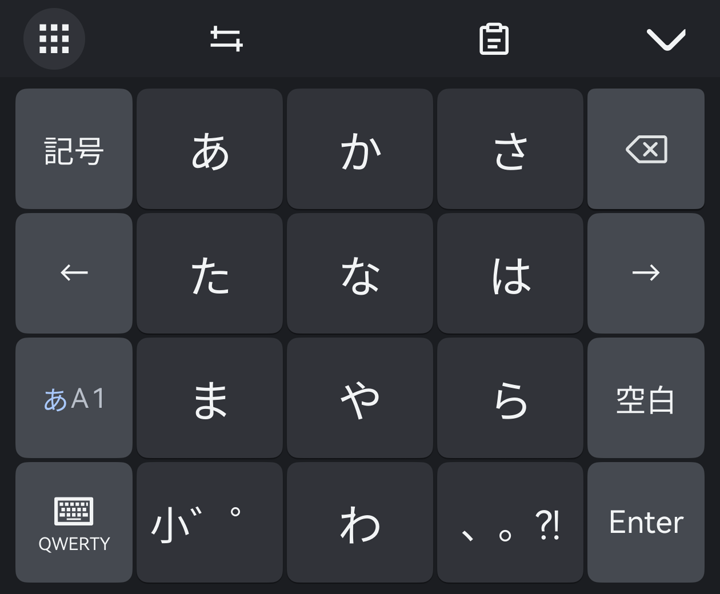
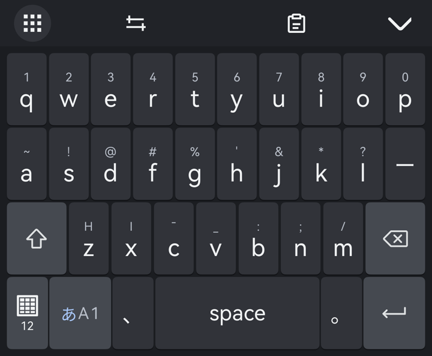
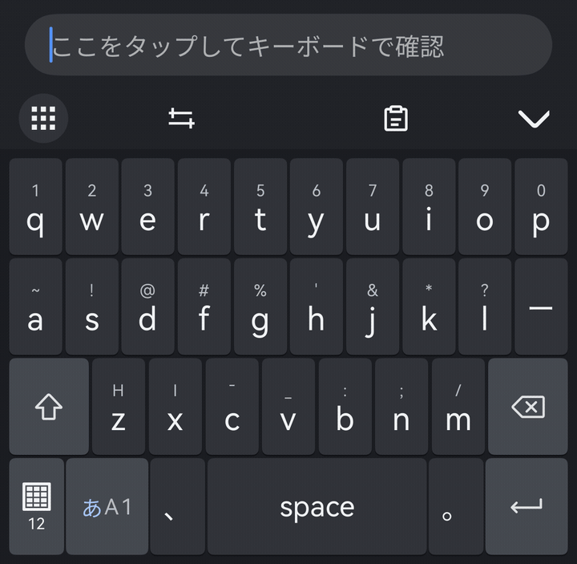

# kanonIME

HarmonyOS向けの日本語・英語キーボード。Mozcによる日本語変換と、12キーフリック・QWERTYに対応しています。

## キーボード

| 12キー | QWERTY |
| --- | --- |
|  |  |

入力 → 候補選択 → 確定の操作例です。

## 主な機能

- 日本語・英語の12キーフリック／QWERTY、数字・記号入力
- 日本語の予測変換、英語の単語補完、文節範囲・入力位置の調整
- クリップボード履歴・ピン留め、テキスト編集
- 端末設定に追従するライト／ダーク配色、画像・GIFの背景
- キーボードの高さ・キー間隔・振動・ショートカットのカスタマイズ

「あA1」で日本語・英語・数字、左下の配列キーで12キー／QWERTYを切り替えます。詳しい操作は[使い方](docs/USAGE.md)を参照してください。

## 導入

1. DevEco Studioでリポジトリのルートを開き、依存関係を同期します。
2. 自分の端末向けの署名を設定し、**release**モードでビルド・インストールします。
3. 端末の入力方式でkanonを選択します。

開発環境はWindows・DevEco Studio 6.1系・HarmonyOS SDK 6.1.1（API 24）・arm64です。署名・コマンド・FULLモードの注意点は[開発ガイド](docs/DEVELOPMENT.md)にまとめています。

開発中です。入力欄によって未確定表示などの対応が異なります。[検証記録](docs/KANON_VALIDATION.md)と[実機確認](tests/device/README.md)を参照してください。

## 資料

- [使い方・設定](docs/USAGE.md)
- [ビルド・実機導入・開発](docs/DEVELOPMENT.md)
- [テストの実行方法](tests/README.md)
- [実装仕様](docs/KANON_SPEC.md)・[IME API契約](docs/IME_API_CONTRACT.md)

## ライセンス

独自部分は[MIT License](LICENSE)。OpenHarmonyの元サンプルに由来するコードはApache-2.0の表記を保持しています。
Mozc・辞書・依存ライブラリのライセンスは[使用OSS一覧](third_party/README.md)と[NOTICE](NOTICE)を参照してください。
