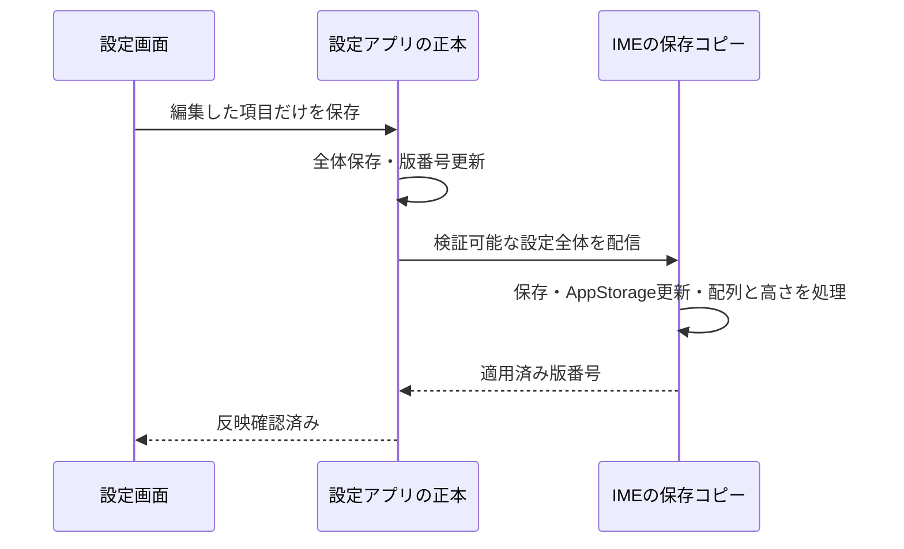

# 設定保存とIMEへの反映

## 対象と責任

通常設定は `KeyboardSettingsSnapshot` に集約する。使用言語と共通配列、フリック切り替え、フリック感度、長押し時間、キーのプレビュー、キー間隔、振動、ショートカットの順序、高さを含む。

- **Model**: 設定の型、既定値、値の検証、差分の適用を管理する。
- **Repository**: `settings_record_v1` に設定全体を一度に保存する。IMEでは正本の受信済みコピーと未同期の変更を同じレコードに保存する。保存成功後にAppStorageへ反映する。
- **Sync**: 同一アプリに限定した共通イベントで取得・変更要求・配信・反映確認を処理する。
- **Receipt**: 通常設定、IME側の変更要求、背景画像について、保存済み・確認待ち・反映済み・通信失敗を同じ規則で扱う。

設定アプリが正本を持ち、版番号を採番する。UIやキー処理からPreferencesやPersistentStorageへ直接保存しない。従来の `KeyboardConfig` の読み込み関数は、互換用の窓口として同じ有効設定を参照する。

## 通常の保存

保存成功と通信成功は別に扱う。通知が失敗したり2秒以内に確認が返らなくても、保存した設定は保持する。画面には同期待ちを表示し、再試行できる。IME起動・キーボード再表示・設定画面の起動と復帰で設定を取得する。

IMEが反映確認を返すのは、受信データを検証し、保存とリアクティブ状態の更新を行い、IME側の適用コールバックが完了した後。配列変更に必要な入力処理が完了しなければ確認を返さず、次の取得時に再評価する。画面上の全ピクセルの描画完了を保証する通知ではない。

## IME側からの変更

言語のオン／オフ、配列キー、高さの決定も `keyboardSettingsSync.save()` を使う。IME側では変更を保存してその場で利用し、正本へ差分を送る。設定アプリが停止中でも自動的に前面起動せず、未同期の変更を保持する。

変更は永続的な送信元IDと連番で管理する。送信するのは先頭の1件だけで、未送信の後続変更は1件にまとめる。送信済みの内容は変更しない。正本は送信元ごとの適用済み連番を保存し、重複通知を再適用せず現在の設定と確認番号を返す。IMEは確認済みの変更だけを削除する。別の設定項目を上書きしないよう、正本には全体ではなく編集した項目の差分を渡す。

送信が途切れた場合の再送は最大3回。その後も未同期データは保持し、次の起動・再表示・手動再試行で再開する。受信した正本の版が古い場合は設定全体を巻き戻さない。未同期の差分は、新しい正本へ重ねて利用する。

## 背景画像

画像・GIFと見た目の調整値は既存の分割転送を維持し、通常設定の小さな通知には含めない。保存とACK待ちは共通のReceiptで管理する。画像の保存が成功し転送だけ失敗した場合は「保存済み・反映待ち」とし、最後の保存済み画像を保持する。IMEの取得要求で転送を再開する。一時プレビューと保存済み背景は別に扱う。

## 旧設定の引き継ぎ

旧GSKVの項目とPersistentStorageを初回に読み込み、検証・正規化した設定全体を保存する。移行が保存できた後だけ、通常設定の旧PersistentStorageの連動を解除する。現在の入力言語の記憶やクリップボードのデータは設定全体とは別に維持する。

旧版でIME側に保存されていた高さや使用言語は、最初の同期で設定アプリへ引き継ぐ。既に新しい設定として明示的に変更した値を移行で戻さない。読み込みに失敗した新形式のレコードを既定値で上書きせず、診断ログに失敗を記録する。

schema 1のキー間隔未定義のデータは受け入れ、コピー・読み取り時に既定値6を補う。既存の設定や未同期変更を破棄しない。キー間隔の変更は通常の差分保存と全体同期を使い、IMEのAppStorage更新から表示スタイルを再計算する。

## ログ

`config` に保存した版、適用した版、未同期件数、反映待ち、失敗コードを記録する。感度・時間・振動・高さなどの設定値は記録できるが、入力本文、候補、画像データやパスは含めない。保存した版とIMEの適用版が一致しているかを確認する。

## 検証と移行計算の境界

`KeyboardSettingsModel`は設定の既定値・検証・差分適用・差分合成を管理する。
`decodeSettingsRecord`は保存JSONを解析し、レコードを検証してからschema 1の不足項目を補完する。
無効なJSONやレコードはエラーとし、既定値の新しいレコードを返さない。

`KeyboardSettingsRepository`は旧PreferencesとAppStorageから値を読み、基本の型を確かめて
`LegacyKeyboardSettings`へ渡す。`KeyboardSettingsMigration`が範囲調整・並びの正規化・既定値補完を行う。
ショートカットの並び計算は`ShortcutConfigValues`に置き、名前・アイコン・PersistentStorageの初期化から分離する。

PCテストは検証・差分・解析・移行計算を実行する。保存先の優先順位、永続化の成功・失敗、通知とACK、
背景画像の保存・同期は別の確認が必要。移行と保存を同じものとして合格扱いしない。

## レコードの更新と保存境界

`SettingsRecordPolicy`は正本とpendingから有効な設定を計算し、差分の追加・末尾合成・peerの重複判定・
受信版とACKの反映を行う。元のレコードを変更せず次のレコードを返し、版の更新には外側から時計値を渡す。
通常の後続編集では送信対象の先頭を変更せず、未送信の末尾だけを合成する。

`SettingsPersistence`はレコード検証・JSON長確認・write・flushをこの順で実行する。
Repositoryはこれが成功した後にメモリのレコードを採用して表示へ反映する。失敗を成功として返さず、自動的にwriteを再試行しない。
flush失敗時の実Preferencesの状態やディスクへの原子的な保存までは、記録用Portのテストで保証しない。

PCテストではpending保持・先頭不変・ACKで確認済みのみ削除・古い版の拒否・peer重複を確認する。
通知の送信・タイマー・再送・受信側の適用完了、Repositoryと実Preferences／AppStorageの配線は別の確認項目とする。

## 保存と適用の確認、再送タイマー

`SettingsReceiptState`は通常設定・IME要求・背景ごとに保存版と適用版を追跡する。
保存版へ到達した適用確認が返るまで「反映待ち」とし、期限切れの待機はfalseを返すが保存版を消さない。
期限後に確認が届けば適用版を更新し、次の待機は確認済みとして扱う。完了した待機の古いタイマーは無視する。
実際のAppStorage表示とメタデータログは`SettingsReceipt`が担当する。

IME要求の適用確認は、自身のactorかつ発行済みsequenceの範囲内だけを受け入れる。
未発行のsequenceによってpendingが残ったまま「反映済み」と表示しない。

`SettingsRetryTimer`は初回送信に加え最大3回、2秒間隔の再送を予約する。
再試行や保存で回数をリセットする場合も、既存の予約期限は維持する。未同期変更がなくなれば停止する。
取消済みのタイマーと、停止前の再送の失敗通知を新しい試行へ適用しない。
送信完了時にpendingが空なら、次の再送を予約しない。

Receipt単体のテストは確認状態・Retry・ACK範囲の判定を扱う。通知・保存・適用を接続したCoreのテストは次節の範囲で実施する。
実CommonEvent・実ストレージ・実UI・実機の確認は別に実施する。

## 通知プロトコルとIME適用待ち

`SettingsSyncCore`は通知・保存・時計・Receipt・診断のPortを受け取り、正本／IMEのプロトコルを実行する。
`KeyboardSettingsSync`は実CommonEventとRepositoryを接続し、既存のイベント名・bundle制限・APIを維持する。
PCテストはCoreの2インスタンスを接続し、保存・送信・受信・適用・ACKの順序と失敗を制御する。

正本がIMEの変更を受領して確認を返した時点で、永続outboxの確認済み項目は除去する。
その後のIME適用は別の待機として管理し、適用失敗でoutboxが空になっても再試行を継続する。
`onApplied`が完了してからIME要求のReceiptを確認し、正本へACKを送る。ACKの送信失敗も再試行対象とする。
適用待ちの間に新しい設定編集が入れば世代を更新し、古い適用の完了で最新の待機を閉じない。
高さの更新要求は適用成功まで保持する。

自動試行の上限へ到達しても保存した設定は保持し、明示的な取得・再試行で適用を再評価する。
適用待ちの制御情報はプロセス内のメモリで管理し、再起動後は通常の取得要求と全体snapshot受信で設定を再評価する。
再起動・CommonEvent・実Preferences・実IME適用の確認は、Coreの接続テストと別に行う。

ACKが2秒の待機期限後に届いた場合、元のsave呼び出しが返したconfirmed=falseは変わらない。
Receiptの表示状態は遅い確認を受けて更新する。期限切れを設定の消失や永続的な失敗と扱わない。
